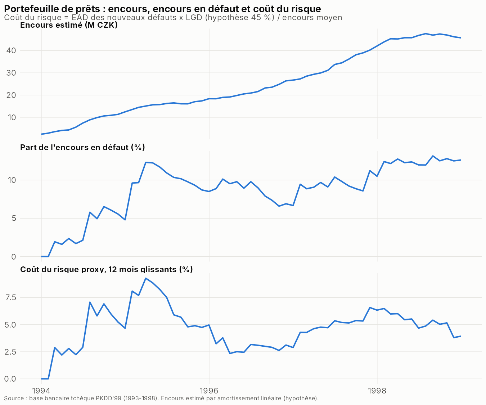
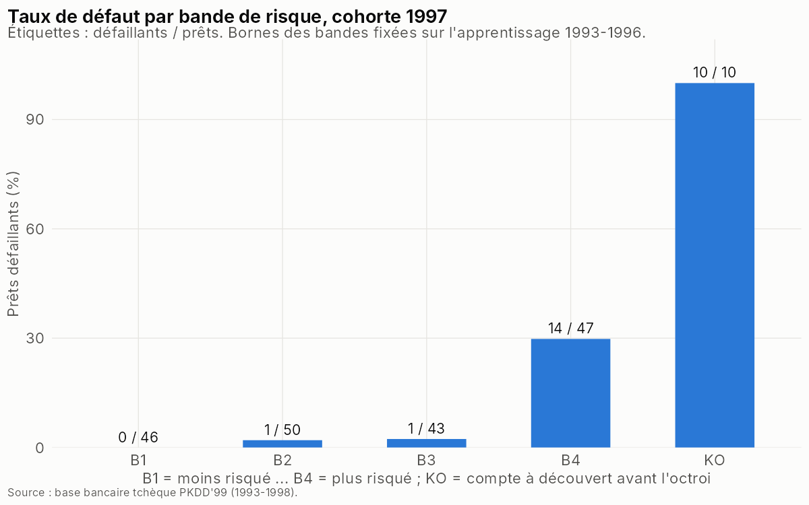
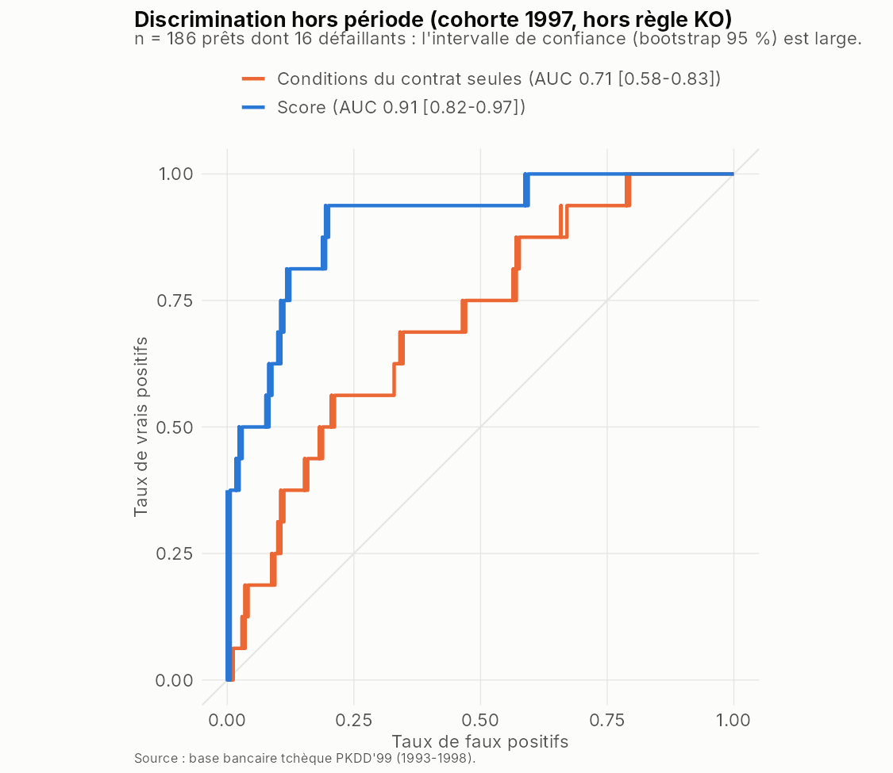
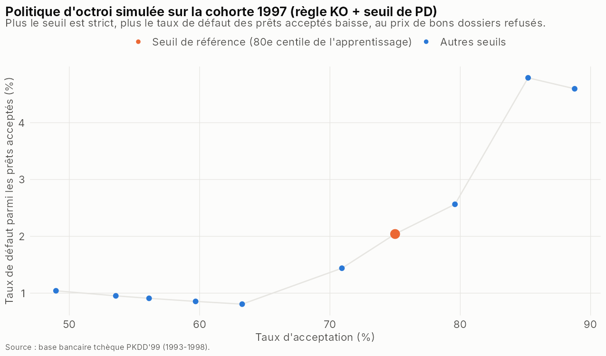

# Pilotage du risque de crédit : PostgreSQL, R, Excel et tableau de bord

**En une phrase :** une banque de détail doit savoir *combien de ses prêts tournent mal, quand, dans quels segments, et à quel coût*, puis décider *qui accepter*. Ce projet reconstitue cette chaîne de bout en bout sur **682 prêts réels** et **1 056 320 opérations bancaires** : entrepôt SQL avec contrôles qualité, indicateurs de portefeuille (encours, part en défaut, coût du risque, cohortes), score d'octroi validé dans le temps, simulateur de seuil dans Excel et tableau de bord HTML.

| | |
|---|---|
| **Données** | Base bancaire tchèque PKDD'99 (P. Berka, M. Sochorová) : 1993-1998, 8 tables, anonymisée. Données réelles, non simulées. |
| **Outils** | PostgreSQL 16 (SQL : schémas, contraintes, fonctions de fenêtre, `LATERAL`, `ROLLUP`) · R (`glmnet`, `pROC`, `dplyr`, `ggplot2`, `plotly`, `openxlsx`, `rmarkdown`, `testthat`) · Excel (formules vivantes) · tables prêtes pour Power BI · GitHub Actions |
| **Livrables** | `outputs/dashboard_risque_credit.html` · `outputs/pilotage_risque_credit.xlsx` · `outputs/powerbi/*.csv` · `outputs/figures/*.png` |



## Résultats

- **Portefeuille** : 76 prêts défaillants sur 682 (11,1 %). Fin 1998 : encours estimé 45,7 M CZK, dont 12,6 % en défaut ; coût du risque proxy sur 12 mois : 3,9 % (LGD de 45 % supposée).
- **Règle de refus automatique** : les 27 prêts dont le compte était déjà à découvert avant l'octroi ont **tous** fini défaillants. Cette règle simple capte 27 des 76 défauts sans aucun modèle.
- **Score d'octroi** (sur les 655 autres prêts, validation dans le temps : apprentissage 1993-1996, test 1997) : **AUC 0,91** sur 1997, intervalle de confiance à 95 % **[0,82 ; 0,97]** (bootstrap stratifié), contre 0,71 [0,58 ; 0,83] pour les seules conditions du contrat (test de DeLong : p = 0,02). En validation croisée par cohorte sur l'apprentissage : 0,84.
- **Bandes de risque (1997, hors règle KO)** : taux de défaut de 0 / 46, 1 / 50, 1 / 43 puis **14 / 47** dans la bande la plus risquée.
- **Politique d'octroi simulée sur 1997** (règle KO + seuil de PD fixé sur l'apprentissage, sans regarder 1997) : 75 % d'acceptation, taux de défaut des acceptés 2,0 % contre 13,3 % sans politique, 23 des 26 défaillants refusés, au prix de 26 bons dossiers refusés (sur 170).

| Bandes de risque (1997) | Courbe ROC (1997) | Politique d'octroi simulée |
|---|---|---|
|  |  |  |

## Ce que le projet démontre

| Compétence | Où |
|---|---|
| Modélisation relationnelle, typage, clés, traduction des codes sources | `sql/01_raw.sql` → `sql/03_constraints.sql` |
| Contrôles qualité automatisés (21 tests, échec bloquant) dont une **réconciliation comptable journalière** (écart max 2,80 CZK sur 814 768 jours-comptes) et un **garde-fou anti-fuite** | `sql/05_dq.sql`, `tests/test_sql_gate.sh` |
| Indicateurs de pilotage : encours mensuel, part en défaut, coût du risque glissant, cohortes (estimateur actuariel), segments (`ROLLUP`) | `sql/04_marts.sql` |
| Variables d'octroi sans fuite d'information (fenêtre strictement antérieure à l'octroi) | `mart.loan_features` |
| Scoring : pénalisation, validation temporelle, intervalles de confiance, comparaison à des références, simulation de seuil | `R/02_model.R`, `R/functions.R` |
| Restitution : classeur Excel (hypothèses modifiables, simulateur à formules, cohortes), tableau de bord HTML, CSV Power BI | `R/04_…`, `R/05_…`, `R/06_…` |
| Tests unitaires R (AUC, KS, bootstrap, prétraitement sans fuite, politique d'octroi) | `tests/testthat/` |

## Exécution

Prérequis : PostgreSQL ≥ 14, R ≥ 4.3 avec `tidyverse DBI RPostgreSQL glmnet pROC openxlsx plotly rmarkdown testthat ragg`, pandoc. LibreOffice est optionnel (il enregistre les valeurs calculées dans le classeur Excel).

```bash
createdb bankrisk                       # puis, si besoin : export PGHOST PGUSER PGPASSWORD PGDATABASE
./run_all.sh                            # données -> SQL -> R -> sorties -> tests (environ 25 s)
```

Le script télécharge les 8 tables depuis un dépôt public **épinglé sur un commit** (`scripts/00_download_data.sh`) ; les données ne sont pas redistribuées dans ce dépôt (vérifier les conditions d'utilisation de la base d'origine avant toute redistribution). Les identifiants par défaut (`yacine`/`bankrisk`) se changent par variables d'environnement.

## Méthode, en bref

1. **Cible.** Défaut = statut B ou D de la base. Contrôle SQL : cela équivaut, sur ces 682 prêts, à « le compte a été à découvert au moins une fois ». La date de défaut retenue est donc le premier solde négatif depuis l'octroi (proxy).
2. **Variables.** Contrat (montant, durée, mensualité), comportement du compte sur les 90 jours *précédant* l'octroi (entrées, solde moyen et minimum, part des retraits en espèces, nombre d'opérations), ancienneté du compte, co-titulaire, carte, chômage du district. Les paramètres de prétraitement sont estimés sur l'apprentissage seul.
3. **Règle KO plutôt que variable.** Un solde négatif avant l'octroi implique mécaniquement le défaut dans cette base. L'inclure comme variable aurait gonflé artificiellement l'AUC : il est traité comme règle de refus et le modèle est ajusté sur le reste.
4. **Validation.** Découpage par date d'octroi (1993-1996 / 1997) ; la cohorte 1998 est exclue de l'évaluation (en moyenne 7 mois d'observation). Choix du modèle par validation croisée *par cohorte*. Seuil de référence fixé sur l'apprentissage.
5. **Coût du risque.** EAD des nouveaux défauts sur 12 mois × LGD / encours moyen. LGD et amortissement sont des **hypothèses** (tableau `mart.assumption`), pas des mesures.

## Limites (à lire)

- **Défaut = découvert**, pas impayé de remboursement : la performance du score est très probablement meilleure que sur un vrai défaut de paiement, et la règle KO (27/27) est une propriété de cette base, pas une loi générale.
- **Petits effectifs** : 76 défauts, dont 16 en validation. L'AUC de 1997 (0,91) est plus élevée que celle de la validation croisée (0,84) : l'intervalle [0,82 ; 0,97] est la bonne mesure de l'incertitude.
- **Cohorte 1998 non jugée** : 4 défauts observés (tous KO) ; le modèle en attend de l'ordre de 13 de plus à maturité parmi les autres prêts, ce qui ne peut pas être vérifié ici.
- **Hypothèses non issues des données** : LGD 45 % (valeur réglementaire Bâle F-IRB), encours par amortissement linéaire, marge illustrative du simulateur Excel (3 %, à remplacer). Aucun recouvrement ni revenu dans la base.
- **Anomalies source** : 30 prêts rattachés à un titulaire de 13-17 ans (conservés, signalés) ; 12 prêts défaillants dont le découvert précède l'octroi (date de défaut imputée à l'octroi) ; 1 district sans taux de chômage 1995.
- **Exclusions volontaires** : genre (non-discrimination), âge (anomalie ci-dessus), table des ordres permanents (non datée : risque de fuite).
- **Périmètre** : banque unique, 1993-1998. Démonstrateur méthodologique, pas un modèle de production. Aucun fichier `.pbix` : les CSV de `outputs/powerbi/` sont prévus pour être chargés dans Power BI (dictionnaire inclus).
- Le workflow `.github/workflows/ci.yml` n'a pas été exécuté sur GitHub : à vérifier au premier push.

## Structure

```
sql/        00_init … 05_dq (exécutés dans l'ordre par sql/run.sh)
R/          00_config, functions, 01_extract, 02_model, 03_figures, 04_export_excel, 05_dashboard.Rmd, 06_export_powerbi
tests/      testthat (fonctions), test_sql_gate.sh (porte qualité)
scripts/    00_download_data.sh
outputs/    dashboard HTML, classeur Excel, CSV Power BI, figures, scored_loans.csv
```

## Source des données

Berka, P., Sochorová, M. — base bancaire du PKDD'99 Discovery Challenge (banque tchèque, 1993-1998, anonymisée). Copie publique utilisée : dépôt GitHub `ldaniel/R_Bank_Berka`, commit `06f32ce72b1df85eeff8556e0d9878f126c0e82f`.

*Auteur : Yacine Yefsah.*
